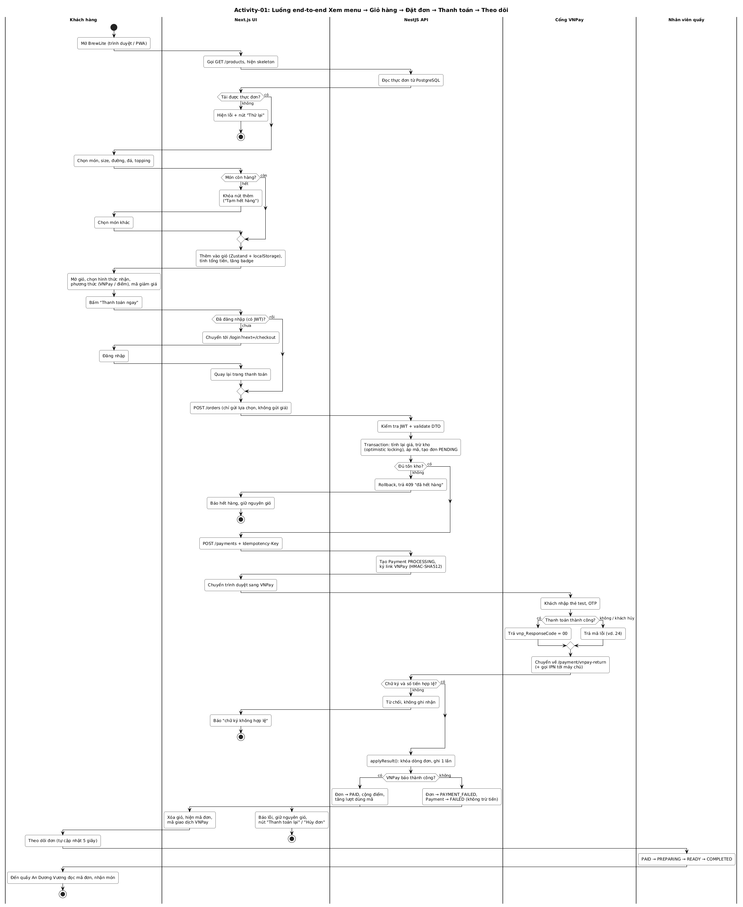
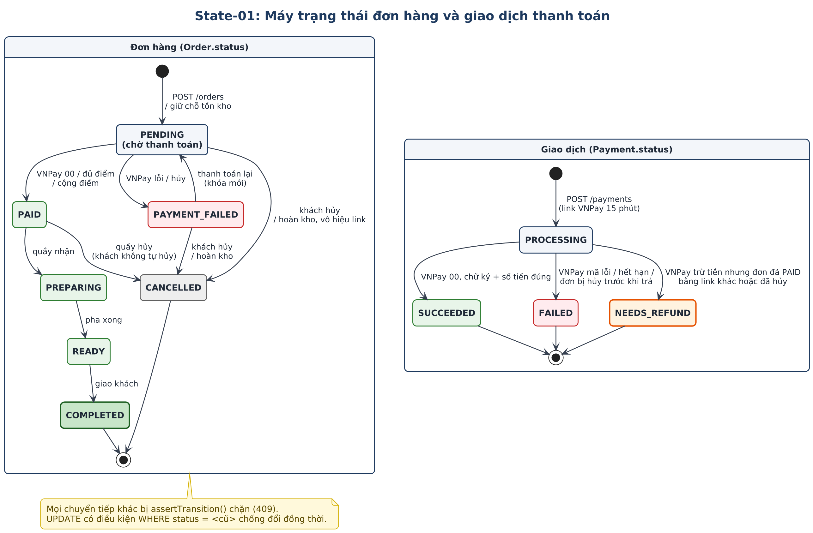

# Sơ đồ mô hình hóa (Task 2)

Các sơ đồ trong chương này vẽ bằng PlantUML; tệp nguồn `.puml` và ảnh `.svg`/`.png` nằm trong `docs/diagrams/`.

## Task 2.1 – Activity diagram

Activity-01 mô tả luồng end-to-end từ xem menu tới nhận món, chia năm swimlane: Khách hàng, Next.js UI, NestJS API, Cổng VNPay, Nhân viên quầy. Sơ đồ có điểm bắt đầu, nhiều điểm kết thúc, decision/merge cho các nhánh thành công/thất bại, và đủ ba trường hợp đề yêu cầu:

- **Hết hàng:** ở giao diện (nút thêm bị khoá "Tạm hết hàng") và ở API (rollback, trả 409 khi đặt).
- **Chưa đăng nhập:** chuyển tới trang đăng nhập rồi quay lại thanh toán.
- **Thanh toán thất bại:** VNPay trả mã lỗi hoặc chữ ký sai → đơn PAYMENT_FAILED, giữ giỏ, cho thanh toán lại.

## Task 2.2 – Sequence diagram

Sequence-01 mô tả UC-06 với đủ các lifeline tối thiểu Customer → Next.js UI → NestJS API → Database → Payment Service (VNPay sandbox). Các điểm đề yêu cầu được thể hiện như sau:

| Yêu cầu | Thể hiện trong Sequence-01 |
|---|---|
| Request/response và thứ tự gọi API | `POST /orders` (bước 3–17) → `POST /payments` (19–27) → redirect VNPay → IPN `GET /payments/vnpay/ipn` → `GET /payments/vnpay/return` |
| Kiểm tra JWT và validate dữ liệu | Bước 4–5 (JwtAuthGuard, ValidationPipe + CreateOrderDto), bước 20 (CreatePaymentDto, định dạng Idempotency-Key) |
| Transaction khi tạo đơn và cập nhật tồn kho | Bước 6–16: BEGIN, SELECT sản phẩm, UPDATE stock có điều kiện `version`, INSERT Order, COMMIT/ROLLBACK |
| Nhánh alt thành công/thất bại | Khối `alt` cuối: thành công (IPN 00 → PAID) và thất bại/khách huỷ (mã 24 → PAYMENT_FAILED) |
| Idempotency khi client gửi lại | Khối `opt` bước 28–31: cùng khoá trả lại giao dịch cũ, `replayed: true` |
| Thông báo kết quả cuối cùng | Bước 44 (xác nhận PAID, mã giao dịch VNPay) và bước 50 (báo thất bại, giữ giỏ) |

## Task 2.3 – Class diagram

Class-01 ở mức domain, bám đúng `backend/prisma/schema.prisma`. Đủ các lớp đề yêu cầu: User, Product, Order, OrderItem, Payment, **Promotion** (hiện thực bằng bảng `Voucher`) và LoyaltyTransaction; thêm Topping và PaymentLog. Sơ đồ có thuộc tính chính, quan hệ kèm multiplicity và các enum trạng thái OrderStatus, PaymentStatus, PaymentMethod, Size, Fulfillment, VoucherType.

| Quan hệ | Multiplicity | Ý nghĩa |
|---|---|---|
| User – Order | 1 – 0..* | Một khách có nhiều đơn |
| Order ◆– OrderItem | 1 – 1..* | Đơn gồm ít nhất một dòng món (xoá đơn thì xoá dòng) |
| Order ◆– Payment | 1 – 0..* | Một đơn có thể có nhiều lần thanh toán (lần trước lỗi thì tạo lần mới) |
| Payment ◆– PaymentLog | 1 – 0..* | Nhật ký trao đổi với VNPay: CREATE, RETURN, IPN, QUERY |
| Product – OrderItem | 1 – 0..* | Dòng món tham chiếu sản phẩm, lưu lại tên và đơn giá lúc đặt |
| Product – Topping | 0..* – 0..* | Mỗi món có danh sách topping dùng được |
| Promotion – Order | 0..1 – 0..* | Đơn áp tối đa một mã |
| User – LoyaltyTransaction | 1 – 0..* | Lịch sử cộng/trừ điểm |

Bổ sung cho Class-01, sơ đồ trạng thái State-01 vẽ vòng đời của Order và Payment, dùng để kiểm thử máy trạng thái.

**Kiểm tra nhất quán:** các trạng thái trong Activity-01 và Sequence-01 (PENDING, PAID, PAYMENT_FAILED, PROCESSING, SUCCEEDED, FAILED) trùng với enum trong Class-01 và trong `schema.prisma`; mọi API trong sơ đồ có trong bảng FR và trong mã nguồn; các luồng thay thế, ngoại lệ của UC-06 đều có nhánh tương ứng trong Activity-01 hoặc Sequence-01.

## Sơ đồ bổ sung (chi tiết theo phần code)

| Sơ đồ | Tệp | Người vẽ |
|---|---|---|
| Tuần tự đăng ký | `sequence-dang-ky.puml` | Trần Anh Trung |
| Tuần tự đăng nhập | `sequence-dang-nhap.puml` | Trần Anh Trung |
| Tuần tự theo dõi đơn | `sequence-theo-doi-don.puml` | Đỗ Chí Thanh |
| Tuần tự huỷ đơn, hoàn kho | `sequence-huy-don.puml` | Lê Bảo Trọng Tấn |

Xuất ảnh: `java -jar plantuml.jar -charset UTF-8 -tsvg -tpng docs/diagrams/*.puml` (cần Graphviz).
